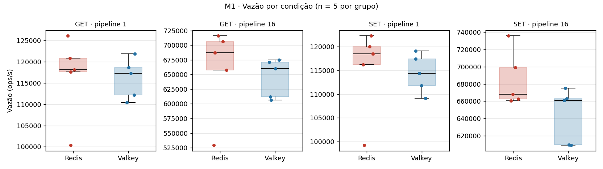
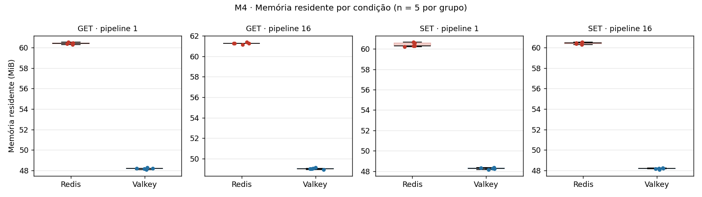
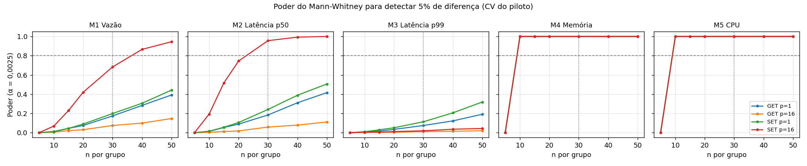
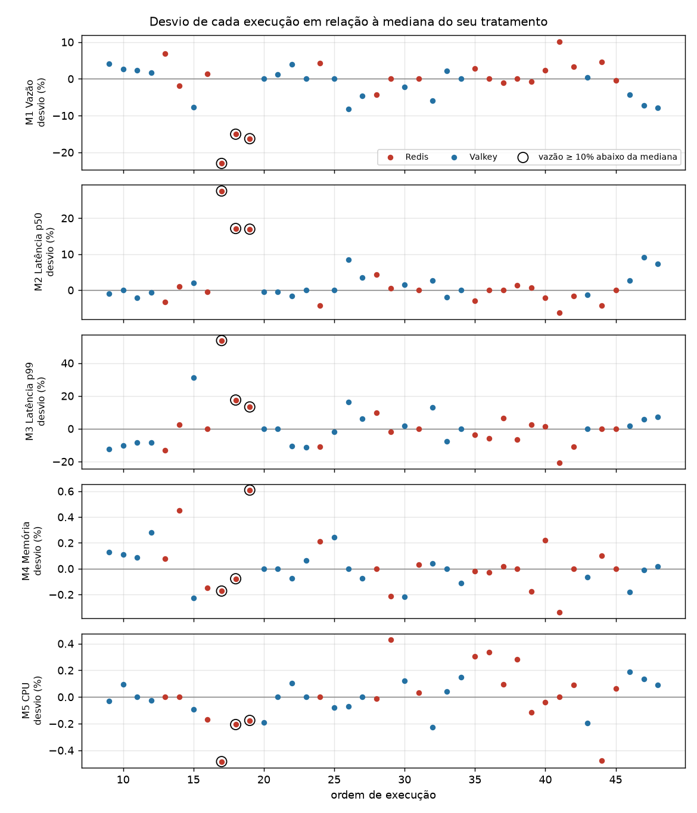

# 4. Ambiente, coleta piloto e análise exploratória

## 4.1 Ambiente do experimento

| Item | Valor |
|---|---|
| Máquina | Notebook Intel Core i5-1135G7 (4 núcleos / 8 *threads*), 31 GiB de RAM |
| Sistema | Linux 6.8 (Ubuntu 22.04), Docker 29.1.3 |
| Servidores | `redis:8.10.3` e `valkey/valkey:9.1.3` (imagens oficiais, configuração padrão) |
| Gerador de carga | `redislabs/memtier_benchmark:2.6.1` |
| Fixação de CPUs | servidor em `0,4` (núcleo físico 0), cliente em `1-3,5-7` (núcleos 1 a 3) |
| Reprodução | `docker-compose.yml` (exploração manual) e `scripts/coleta_experimento.py` (coleta) |
| Bibliotecas de análise | `requirements.txt` (versões fixadas) |

*Digests* das imagens, semente e ordem sorteada estão em [`data/raw/piloto/metadados.json`](../data/raw/piloto/metadados.json).

## 4.2 Execução do piloto

- **Data:** 19/11/2026, das 17:19 às 17:46 (UTC), cerca de 26 min.
- **Plano:** 8 tratamentos × 5 repetições = 40 execuções medidas, mais 8 de aquecimento (descartadas por desenho). Ordem sorteada com semente 20261119. Carga de 30 s por execução.
- **Comando:** `python3 scripts/coleta_experimento.py --coleta piloto --repeticoes 5`

### Validação ([results/piloto/validacao.md](../results/piloto/validacao.md))

| Item | Quantidade |
|---|---|
| Registros | 48 |
| Aquecimento (descartados por desenho) | 8 |
| **Execuções válidas** | **40** (5 por tratamento, todos completos) |
| Descartadas por problema (V1, V3–V9) | 0 |
| Erros de conexão, versão divergente, *misses* no `GET` | 0 |
| Execuções com algum *outlier* sinalizado (não removidas) | 15 |

## 4.3 Análise exploratória

> Com n = 5 por grupo, os testes são **exploratórios**. Servem para validar o script de análise e ver a ordem de grandeza dos efeitos, **não para concluir**. Com 20 testes e correção de Holm, o Mann-Whitney com n = 5 nem consegue chegar a p < 0,05: o menor p bilateral possível é 2/252 ≈ 0,008, que vira 0,16 depois do ajuste.

Tabelas completas: [descritiva.md](../results/piloto/descritiva.md) e [testes.md](../results/piloto/testes.md).

| Métrica | Condição | Mediana Redis | Mediana Valkey | Diferença | Leitura no piloto |
|---|---|---|---|---|---|
| M1 Vazão (ops/s) | GET p=1 | 118.114 | 117.248 | −0,7% | sem diferença visível |
| | GET p=16 | 687.238 | 659.925 | −4,0% | Valkey abaixo, mas grupos se sobrepõem |
| | SET p=1 | 118.479 | 114.365 | −3,5% | idem |
| | SET p=16 | 668.095 | 660.813 | −1,1% | idem |
| M2 Latência p50 (ms) | 4 condições | 1,50 a 4,54 | 1,53 a 4,77 | +2,1% a +4,9% | Valkey levemente mais lento em todas (δ de Cliff 0,36 a 0,60) |
| M3 Latência p99 (ms) | 4 condições | 3,57 a 9,79 | 3,62 a 9,09 | −7,8% a +6,0% | muito ruído (CV até 23%) |
| **M4 Memória (MiB)** | 4 condições | ≈ 60,4 | ≈ 48,2 | **≈ −20%** | **Valkey usa ~12 MiB a menos, em todas as condições, sem sobreposição** (p Holm < 0,001) |
| M5 CPU (% de 1 núcleo) | 4 condições | ≈ 101 | ≈ 101 | 0% | servidor saturado nos dois casos (ver problema P3) |

Os demais gráficos estão em [results/piloto/](../results/piloto/): `boxplot_lat_p50_ms.png`, `boxplot_lat_p99_ms.png`, `boxplot_cpu_medio_pct.png` e `interacao_vazao.png` (H-6).

**Teste escolhido.** Pelo Shapiro-Wilk, a maioria dos grupos passou por normal, então o script escolheu o t de Welch em 17 dos 20 testes. Com n = 5 o Shapiro-Wilk tem pouco poder, então essa escolha só vale para testar o fluxo. Na coleta completa a decisão é refeita com n = 30.

## 4.4 Simulação de poder e erro tipo I ([results/piloto/poder.md](../results/piloto/poder.md))

Reaproveitando o Lab04, o Mann-Whitney foi simulado 2.000 vezes por cenário, com dados log-normais que têm o CV observado no piloto.

- **Erro tipo I** (H0 verdadeira, n = 30, α = 0,05): taxa de rejeição entre 0,037 e 0,054, média de 0,046. O teste está calibrado.
- **Poder para detectar 5% de diferença com n = 30:**

| Métrica | CV no piloto | Poder (α = 0,05) | Poder (α = 0,0025, Holm no pior caso) |
|---|---|---|---|
| M4 Memória, M5 CPU | 0,2% a 0,3% | 1,00 | 1,00 |
| M2 Latência p50, SET p=16 | 3,7% | 1,00 | 0,96 |
| M1 Vazão, SET p=16 | 4,9% | 0,95 | 0,68 |
| M1 Vazão e M2 p50, demais condições | 7,5% a 12,5% | 0,30 a 0,68 | 0,06 a 0,24 |
| M3 Latência p99 | 9% a 23% | 0,12 a 0,51 | 0,01 a 0,11 |

**Conclusão:** com a variabilidade do piloto, **n = 30 não basta** para detectar 5% em vazão e latência. Ou se reduz a variabilidade, ou se aumenta o n (ver ajustes A1 e A4).

## 4.5 Diagnóstico de deriva temporal ([results/piloto/ordem.md](../results/piloto/ordem.md))

O `scripts/diagnostico_ordem.py` mede o desvio de cada execução em relação à mediana do seu tratamento e o coloca contra a ordem de execução. Isso deixa as 8 condições na mesma escala e mostra se a máquina mudou de comportamento durante a coleta. Nada é removido da análise principal: é um diagnóstico para o problema P1 e para as ameaças à validade.

- **Episódio confirmado (ordem 17–19, 17:28–17:29 UTC).** São as únicas execuções com vazão 10% ou mais abaixo da mediana do tratamento (−15% a −23%), com latência p50 17% a 28% maior ao mesmo tempo. Memória e CPU quase não mudam (< 1%), o que aponta para perda de desempenho da máquina (frequência da CPU), e não para um problema do servidor. As três são do Redis, por acaso do sorteio.
- **Segundo efeito, mais fraco, no fim da coleta.** As três últimas execuções do Valkey (ordem 46–48, 17:44–17:45 UTC) ficaram 4% a 8% abaixo da mediana em vazão, com latência maior. Isso aparece como tendência de queda do Valkey ao longo da coleta (Spearman ρ = −0,58 entre ordem e desvio da vazão, p = 0,008; latência p50: ρ = +0,49). O Redis não mostra tendência (ρ = +0,33, p = 0,15). É compatível com a bateria descarregando, mas com n = 20 e 15 correlações sem ajuste, é um indício, não uma conclusão.
- **Sensibilidade.** Sem as execuções 17–19, a vantagem do Redis em vazão e latência p50 **aumenta** 0,3 a 1,5 p.p. (por exemplo, vazão `GET` p=16: −4,0% → −5,3%; p50 `GET` p=16: +3,6% → +5,1%), porque a interferência caiu justamente sobre o Redis. A memória não muda (−20% nos dois casos).

**Leitura:** a aleatorização funcionou como esperado (a interferência não se concentrou num tratamento de forma sistemática), mas com n = 5 três execuções ruins bastam para mover a diferença em vazão e latência para perto do limiar de 5%. Isso reforça o ajuste A1. No mini-piloto da S02, o critério de aceite passa a incluir: **nenhuma execução sinalizada pelo `diagnostico_ordem.py` e nenhuma tendência com |ρ| > 0,3 em M1–M3**.

> **Revisado na S02** ([docs/05, D1](05-revisao-piloto-tamanho-amostra.md#51-d1-deriva-temporal)): a tendência só reprova se |ρ| > 0,3 **e** p < 0,05 com todas as execuções juntas. O critério acima reprovaria 79% das coletas sem deriva.

## 4.6 Problemas encontrados e ajustes no plano

| # | Problema observado no piloto | Ajuste para a coleta completa (S02) |
|---|---|---|
| P1 | **Ambiente ruidoso.** A coleta rodou com o notebook **na bateria** e com o governador de CPU em `powersave`, contrariando o plano ("na tomada, alto desempenho"). As execuções 17, 18 e 19 (17:28–17:30 UTC, todas Redis por acaso do sorteio) tiveram vazão ~15% menor e latência maior ao mesmo tempo, sinal de interferência passageira (frequência da CPU ou processo em segundo plano). Isso inflou o CV para 8 a 23%. | **A1.** Coletar **na tomada**, com governador `performance` (`sudo cpupower frequency-set -g performance` ou `powerprofilesctl set performance`), aplicativos fechados e sem usar a máquina durante a coleta. O script passou a gravar nos metadados se a máquina está na tomada e o perfil de energia. Antes da coleta completa, rodar um **mini-piloto** (`--repeticoes 3`) para confirmar que o CV caiu e que o `diagnostico_ordem.py` não sinaliza deriva (seção 4.5). |
| P2 | O *pinning* do plano (servidor `0-1`, cliente `2-5`) colocava cliente e servidor no **mesmo núcleo físico** (as CPUs 1 e 5 são o mesmo núcleo nesta máquina). | **A2.** Servidor em `0,4` e cliente em `1-3,5-7` (já aplicado no piloto e no plano). Parâmetros configuráveis por linha de comando para outras máquinas. |
| P3 | **M5 tem efeito teto.** Com 200 conexões, os dois servidores ficam saturados (~101% de um núcleo, CV 0,2%). A métrica mostra que o servidor está no limite, não quanto CPU ele gasta por trabalho feito (problema de **validade de construto**). | **A3.** Complementar M5 com uma condição de **carga fixa** abaixo da saturação (`memtier --rate-limiting`), em que a CPU vira comparável, ou trocar M5 pela métrica derivada **CPU por 100 mil operações** (`cpu_medio_pct / ops_s × 10⁵`). A escolha fica para a S02. |
| P4 | **Poder insuficiente com n = 30** para 5% em vazão e latência (seção 4.4). | **A4.** Depois do A1, rodar de novo `simulacao_poder.py` com o CV do mini-piloto. Se o poder continuar < 0,8, aumentar o n (o script aceita `--repeticoes`) ou restringir a família de testes do Holm às hipóteses principais (H-1 a H-3). |
| P5 | A leitura de CPU do `docker stats` repetia cada valor (atualiza a cada 0,5 s) e incluía segundos antes de a carga começar. | **A5.** Já corrigido: leituras com ≥ 0,75 s de distância, dentro da janela `Start time`–`Finish time` do memtier, descartando os 2 s iniciais. |
| P6 | Com n = 5 o Shapiro-Wilk quase nunca rejeita a normalidade, então o t de Welch foi escolhido na maioria dos casos. | **A6.** Manter o fluxo de decisão do plano. Com n = 30, conferir também o Q-Q plot antes de escolher o teste. |

**Decisões da S02** sobre A1, A3 e A4: [docs/05-revisao-piloto-tamanho-amostra.md](05-revisao-piloto-tamanho-amostra.md). Resumo: ordem em blocos e checagem do ambiente pelo coletor (A1), condição de carga fixa para a CPU (A3) e n = 50 por tratamento (A4).

## 4.7 O que o piloto já indica (a confirmar na S02)

- **Memória:** o Valkey 9.1 ocupou cerca de **20% menos memória residente** que o Redis 8.10 com a mesma base (100 mil chaves de 256 bytes). O efeito é grande e estável, e é o candidato mais forte a resultado da S02.
- **Vazão e latência:** diferenças de 0 a 5%, quase todas a favor do Redis, mas dentro do ruído do piloto. Ainda não dá para afirmar nada.
- **CPU:** não é comparável no desenho atual (P3).
